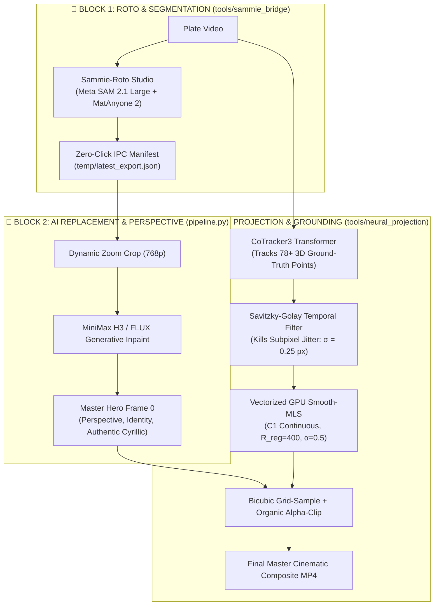
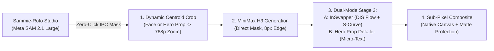
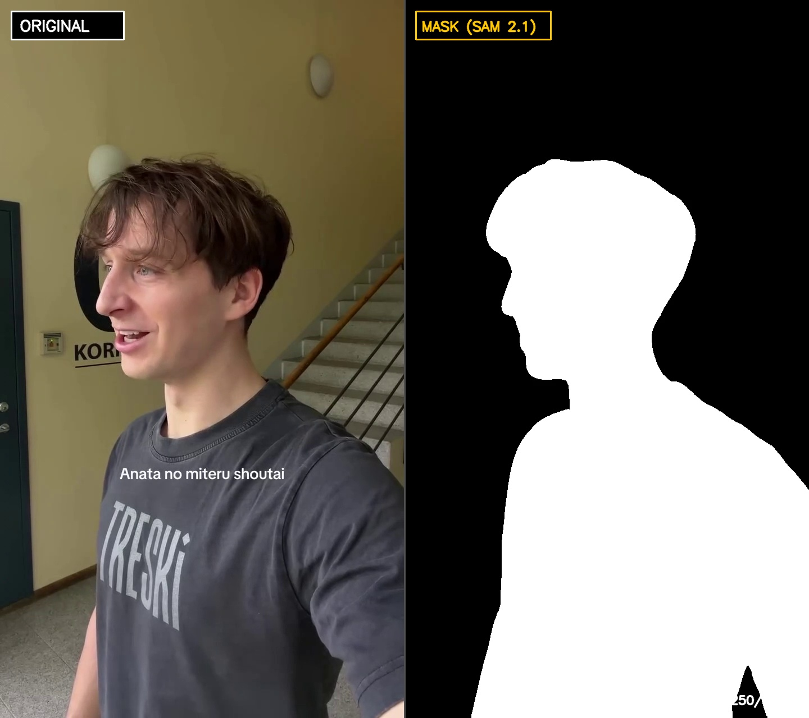

# MiniMax H3 VFX Studio: The 3-Pillar Architecture (Roto + DiT Inpaint + Precision Neural Projection) 🎬🎭📦

[](https://github.com/neohh/minimax-h3-faceswap-pipeline/releases)
[](https://www.python.org/)
[](https://github.com/comfyanonymous/ComfyUI)
[](tools/sammie_bridge)
[](tools/neural_projection)
[](LICENSE)

A production-grade VFX suite divided into **3 modular, decoupled studio blocks** designed for cinematic actor face replacement and micro-detail hero prop replacement (authentic packaging, Cyrillic typography, folded newspapers, specular glass).



---

## 🏛️ The 3 Independent VFX Studio Pillars

| Block | Role & Tools | Key Innovation |
| :--- | :--- | :--- |
| **Block 1: Roto & Matting** | [`tools/sammie_bridge/`](tools/sammie_bridge/) | **Zero-Click IPC Bridge**: Meta SAM 2.1 Large + MatAnyone 2 with instant timeline hot-reloading and automated export handshakes. |
| **Block 2: AI Replacement** | [`pipeline.py`](pipeline.py) / [`tools/auto_inpaint.py`](tools/auto_inpaint.py) | **Dynamic Centroid Zoom**: Solves DiT $8\times$ latent compression by zooming into a dynamic 768p bounding box for authentic identity and Cyrillic typography («ПРАВДА», «КОСМОС»). |
| **Block 3: Neural Projection** | [`tools/neural_projection/`](tools/neural_projection/) | **CoTracker3 + Smooth-MLS**: Eliminates diffusion hallucinations, optical flow drift, Delaunay polygon facets, and homography corner jitter with $C^1$-smooth continuous deformation. |

---

## 🚀 What's New in v2.6.0: The Complete VFX Trifecta Release

* **🌟 Block 3: Neural Texture Projection Engine (`tools/neural_projection`)**:
  * **CoTracker3 3D Neural Point Tracking**: Locks onto 78+ physical anchor points across long shots without cumulative optical flow drift.
  * **Savitzky-Golay Temporal Jitter Elimination**: Filters out raw neural micro-tremors ($0.2\text{--}0.4\text{ px}$), reducing corner trajectory variance down to $\sigma = 0.25\text{ px}$ without phase lag.
  * **Smooth Moving Least Squares (Smooth-MLS)**: Eliminates Delaunay triangle facet seams and the wavy "jello effect" using broad-radius regularization ($R_{\text{reg}} = 400.0, \alpha = 0.5$).
  * **Organic Overscan & Alpha-Clipping**: 40px bounding box overscan combined with 7px morphological dilation and Gaussian feathering for zero border seams.
* **⚡ Standalone 1-Click Batch Runner**: `tools/neural_projection/neural_projection.bat`.

---

## 🚀 What's New in v2.5.0: Universal Props & Zero-Click Roto Bridge

* **⚡ Zero-Click Sammie-Roto Studio IPC Bridge (`tools/sammie_bridge`)**:
  * Seamless bi-directional automation between the agent/pipeline and **Sammie-Roto (Meta SAM 2.1 Large + MatAnyone 2)**.
  * **Hot-Reload Timeline on the Fly**: Instantly swaps the active video timeline via a lightweight IPC command channel (`temp/sammie_ipc_command.json`) without unloading or re-initializing SAM2 models from VRAM (RTX 5080).
  * **Auto-Export Manifest Handshake**: Whenever a mask is exported, Sammie-Roto automatically logs `temp/latest_export.json` with the exact path. The pipeline grabs the fresh mask in 0.001s with zero manual path entry.
  * **Native Drag & Drop Tool**: Standalone `Загрузить_видео_в_Sammie.exe` and `Sammie-Roto.exe` with embedded visual icons for 1-click video staging.
* **📦 Beyond Faces: Universal Hero Props & Full Characters**:
  * Extends the 4-stage Dynamic Zoom architecture to solve **micro-typography and prop replacement** (e.g. cigarette packs with legible text, newspapers with column print, glass reflection).
  * Uses a two-pass strategy: Pass 1 establishes global scene/environmental lighting, and Pass 2 isolates the hero prop in a dynamic high-resolution crop ($768\text{p}$) to overcome the $8\times$ DiT latent compression bottleneck.
* **🎬 High-Speed Side-by-Side Reviewer (`combine_side_by_side.py`)**:
  * Fast PyAV/libx264 multi-threaded tool to render synchronous Original vs Mask split-screen videos with frame counters for instant QA verification.

---

## 🚀 What's New in v2.0.0: VFX Temporal Coherence Release

* **🌊 Dense Optical Flow Temporal Warping (DIS Flow)**:
  * Eliminates high-frequency skin texture flutter and frame-to-frame micro-flicker by computing backward motion vectors between frames $t$ and $t-1$.
  * Coherently blends forward-warped previous swaps ($35\%$) with the current frame ($65\%$), locking facial features rigidly to the moving skull.
* **📐 S-Curve Smoothstep Face Gate (Extreme Tilt Anti-Popping)**:
  * Automatically detects vertical head tilt (Pitch $> 35^\circ$, looking straight up into lights/disco balls).
  * Seamlessly fades swap strength down to $0\%$ via cubic smoothstep, allowing natural diffusion inpainting to handle the throat and jaw without 2D projective shearing or popping.
* **🚫 Pure Optical Sharpening (Zero GPEN Plastic Distortion)**:
  * Replaces artificial face-enhancement models (GPEN/GFPGAN) that cause uncanny-valley plastic grimaces and unnatural eye shapes with gentle optical micro-contrast sharpening.
* **🎯 Dynamic 3D Mask Centroid Tracking**:
  * The head crop dynamically follows the 3D centroid of the user's ground-truth mask, ensuring the face stays framed tight regardless of dancer displacement.

---

## 🔍 The Problem: Why Standard Pipelines Fail

When replacing an actor in a medium or wide shot where the head tilts down or turns into profile:

```
Full Canvas (720x1280) ──> Face is ONLY 50x70 px! ──> VAE 8x compression ──> 7x9 Latent Tokens!
```

1. **The Latent Bottleneck & Eye Drift (MiniMax / Wan / DiT)**:
   * In a $720 \times 1280$ video, the actor's face often occupies merely $50 \times 70$ pixels.
   * Spatial VAE downsampling ($8\times$ or $16\times$) compresses the entire head into just **$7 \times 9$ latent tokens**. Both eyes together occupy **less than 1 latent patch**!
   * The diffusion model cannot resolve eyelids or pupils at this scale, resulting in "underwater/rubber-face" deformation: upon downward head tilt, the eyes morph and drift apart rather than rigidly following the skull.
2. **Why 2D Face-Swappers (InSwapper, FaceFusion, ReActor) Flicker & Drop Frames**:
   * SCRFD / RetinaFace detectors run autonomously per frame.
   * When the head turns towards profile ($>45^\circ$) or tilts steeply, facial confidence scores drop below the threshold (`det_thresh`).
   * Standard nodes skip frames with 0 detected faces, flashing the original face for 1–2 frames (violent flickering / «слёт»).

---

## 💡 The Solution: 4-Stage Hybrid Studio Pipeline



### Stage 1: Dynamic Centroid Crop (768p Zoom)
Instead of wasting 96% of the GPU compute budget on background tables and streets, the script extracts a dynamic bounding box centered around the target's rotoscoped mask (generated in 1-click via the **Sammie-Roto Studio Bridge**), upscaling it to native **$768 \times 768$**.
* **Face / Prop resolution jumps $10\times$**: In a wide shot, a $50\text{px}$ face or cigarette pack becomes $500\text{px}$.
* **Latent token preservation**: Overcomes the $8\times$ VAE downsampling limit. Eyelids or micro-typography ("КОСМОС", newspaper print columns) now occupy dozens of latent tokens instead of collapsing into blurred blobs.

### Stage 2: MiniMax H3 with Direct Mask Guidance
* Automated person segmentation is bypassed.
* The user's hand-crafted video mask (`mask.mp4`) is fed directly into `H3RelayExpandMask` with a tight `expansion_px: 8`.
* MiniMax H3 replaces only the targeted object or head, using undisturbed surroundings as rigid geometric anchors.

### Stage 3: Dual-Mode Detailer
* **Mode A: Actor Likeness (VFX Rock-Solid InSwapper)**:
  * Adaptive SCRFD detection threshold ($0.20$) for steep profiles.
  * Zero-Drop Continuous Interpolation across extreme occlusions.
  * 5-Frame moving average landmark smoothing.
  * **DIS Optical Flow Temporal Warping**: Rigidity links consecutive frames.
  * **S-Curve Face Gate**: Smoothly modulates swap intensity across extreme perspective tilts.
* **Mode B: Hero Prop & Object Detailer (Micro-Text & Print)**:
  * High-resolution second-pass latent refinement for fine typography, logos, packaging, and specular glassware.

### Stage 4: Sub-Pixel Native Compositing & Foreground Protection
* The swapped $768\text{p}$ head is downsampled back to native patch coordinates and pasted directly into the native canvas.
* **Foreground Occlusion Protection**: User's alpha matte (e.g. wind chime tubes or dancer hands) is composited on top, keeping foreground objects $100\%$ crisp and unblurred.

---

## 🛠️ Requirements

```bash
pip install -r requirements.txt
```

* Python 3.10+
* OpenCV (`opencv-python`)
* InsightFace (`insightface`, `onnxruntime-gpu`)
* Docker container with ComfyUI & MiniMax H3 DiT installed.

---

## 🎬 Quick Start

```python
from pipeline import (
    step1_prepare_crop,
    step2_generate_minimax_h3,
    step3_rock_solid_inswapper_v2,
    step4_pixel_perfect_composite_v2
)

# 1. Dynamic crop around 3D mask
crop_coords, canvas_res, fps = step1_prepare_crop(
    source_video="input_scene.mp4",
    mask_video="user_face_mask.mp4",
    num_frames=56,
    crop_sz=220,
    dynamic_track=True
)

# 2. Diffusion base inpaint (MiniMax H3)
h3_output = step2_generate_minimax_h3("workflow/minimax_user_mask_crop_workflow.json")

# 3. VFX-Grade Rock-Solid Swapper (with Optical Flow & S-Curve Gate)
swapped_frames = step3_rock_solid_inswapper_v2(
    input_video=h3_output,
    ref_image="reference_face.jpg",
    output_swapped_video="swapped_crop.mp4",
    enable_optical_flow=True,
    enable_pitch_gate=True
)

# 4. Pixel-perfect compositing back to canvas
step4_pixel_perfect_composite_v2(
    source_video="input_scene.mp4",
    mask_video="user_face_mask.mp4",
    holdout_matte="foreground_matte.mp4",
    swapped_frames=swapped_frames,
    crop_coords=crop_coords,
    output_master_video="final_master_output.mp4"
)
```

---

## 🖌️ Zero-Click Sammie-Roto Studio Bridge

Located in [`tools/sammie_bridge/`](tools/sammie_bridge/):



The pipeline integrates seamlessly with **Sammie-Roto (Meta SAM 2.1 Large + MatAnyone 2)** for instant, zero-friction rotoscoping:

1. **Launch Studio**: Run `Sammie-Roto.exe` (or `Sammie-Roto.bat`).
2. **Hot-Reload Video into Timeline**:
   ```bash
   python tools/sammie_bridge/send_to_sammie.py "path/to/video.mp4"
   ```
   Or drag-and-drop any video directly onto `Загрузить_видео_в_Sammie.exe` on your desktop.
3. **Rotoscoping**: Click positive/negative points on the face or object, hit **Propagate** (SAM 2.1 Large), and click **Export**.
4. **Zero-Click Handshake**: Sammie-Roto automatically writes `temp/latest_export.json`. The pipeline immediately detects the exported mask path and begins Stage 1.
5. **Quality Verification**:
   ```bash
   python tools/sammie_bridge/combine_side_by_side.py
   ```
   Generates a synchronized split-screen comparison video (Original vs Mask) to verify boundary tightness before inpainting.

---

## 📐 Block 3: Precision Neural Projection Engine (CoTracker3 + Smooth-MLS)

Located in [`tools/neural_projection/`](tools/neural_projection/):

When inpainting fine typography, newspaper column grids, or branded packaging (such as Soviet **«ПРАВДА»** or **«КОСМОС»**), standard video diffusion models hallucinate and melt text from frame to frame. Block 3 resolves this by decoupling **spatial identity generation** (Block 2) from **temporal geometric tracking** (Block 3).

### Why Pure Smooth-MLS Wins
* **No Delaunay Facet Seams**: Delaunay triangulation is piecewise-affine ($C^0$-continuous), causing sharp polygonal fracture lines across smooth surfaces. Smooth-MLS computes a $C^1$-continuous deformation field.
* **No Homography Corner Jitter**: Planar homography assumes flat 2D geometry; non-coplanar 3D props (like a cigarette pack standing on a folded newspaper) cause RANSAC to tilt and jitter wildly ($\sigma = 38.46\text{ px}$). Smooth-MLS isolates local deformations smoothly.
* **No Jello Micro-Waviness**: Broad regularized weighting ($R_{\text{reg}} = 400.0, \alpha = 0.5$) prevents local potential wells from warping flat paper surfaces.
* **Temporal Savitzky-Golay Filtering**: Trajectory smoothing ($w=7, p=2$) eliminates neural point trembling ($\sigma = 0.25\text{ px}$).

### Usage (CLI)
```bash
tools\neural_projection\neural_projection.bat ^
    --video "path/to/plate.mp4" ^
    --mask "path/to/mask.mp4" ^
    --hero "path/to/hero_frame0.png" ^
    --output "path/to/master_composite.mp4"
```

---

## 📄 License
MIT License. Created by [neohh](https://github.com/neohh).
