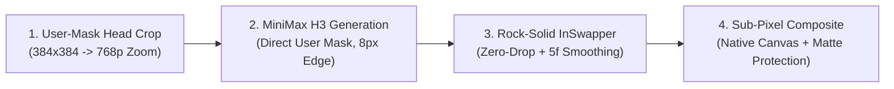
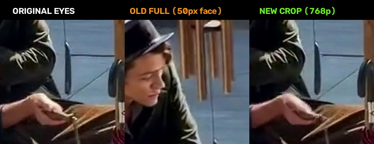
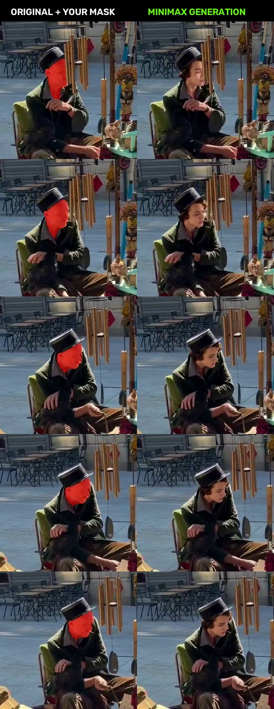
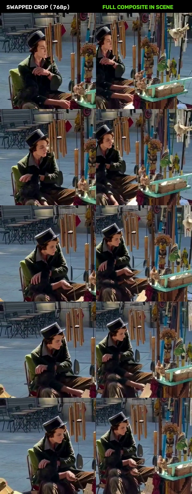
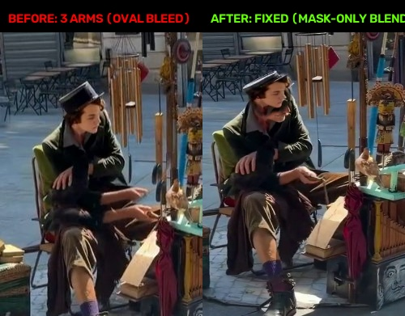
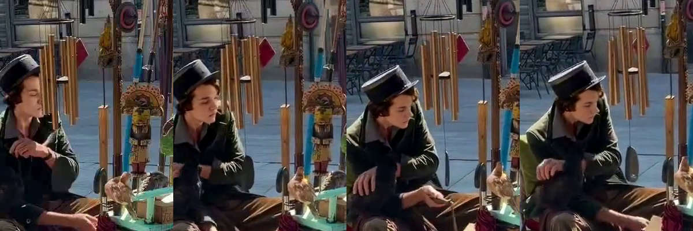

# MiniMax H3 Head-Crop + Rock-Solid InSwapper Pipeline 🎬🎭

[](https://github.com/neohh/minimax-h3-faceswap-pipeline)
[](https://www.python.org/)
[](https://github.com/comfyanonymous/ComfyUI)
[](LICENSE)

A production-grade, 4-stage hybrid pipeline for cinematic actor replacement and face swapping on complex 3D head turns, profile rotations ($90^\circ$), and downward perspective tilts.

Combines the 3D volumetric consistency of **MiniMax H3 (`ref2va` DiT)** with the pixel-perfect identity likeness of **InSwapper**, eliminating the "rubber-face" diffusion eye drift and frame flickering.

---

## 🔍 The Problem: Why Standard Pipelines Fail

When replacing an actor in a medium or wide shot where the head tilts down or turns into profile:

```
Full Canvas (720x1280) ──> Face is ONLY 50x70 px! ──> VAE 8x compression ──> 7x9 Latent Tokens!
```

1. **The Latent Bottleneck & Eye Drift (MiniMax / Wan / DiT)**:
   * In a $720 \times 1280$ video, the actor's face often occupies merely $50 \times 70$ pixels.
   * Spatial VAE downsampling ($8\times$ or $16\times$) compresses the entire head into just **$7 \times 9$ latent tokens**. Both eyes together occupy **less than 1 latent patch**!
   * The diffusion model cannot resolve eyelids or pupils at this scale, resulting in "underwater/rubber-face" deformation: upon downward head tilt, the eyes morph and drift apart rather than rigidly following the skull.
2. **Why 2D Face-Swappers (InSwapper, FaceFusion, ReActor) Flicker & Drop Frames**:
   * SCRFD / RetinaFace detectors run autonomously per frame.
   * When the head turns towards profile ($>45^\circ$) or tilts steeply, facial confidence scores drop below the threshold (`det_thresh`).
   * Standard nodes skip frames with 0 detected faces, flashing the original face for 1–2 frames (violent flickering / «слёт»).

---

## 💡 The Solution: 4-Stage Hybrid Pipeline



### Stage 1: Tight Head Crop (768p Zoom)
Instead of wasting 96% of the GPU compute budget on background tables and streets, the script extracts a $384 \times 384$ px box centered around the user's rotoscoped face mask (with margins for hair curls and collar), upscaling it to native **$768 \times 768$**.
* **Face resolution jumps from 50 px to 500 px** ($10\times$ increase).
* **Each eye grows to ~50 px** — the VAE now has dozens of latent tokens to cleanly preserve eyelid curvature and perspective foreshortening.

### Stage 2: MiniMax H3 with Direct Mask Guidance
* Automated SAM3 person segmentation is bypassed.
* The user's hand-crafted video mask (`mask.mp4`) is fed directly into `H3RelayExpandMask` with a tight `expansion_px: 8`.
* MiniMax H3 replaces only the face and cap, using the undisturbed original hair and neck as rigid geometric anchors.

### Stage 3: Rock-Solid InSwapper (Zero-Drop Guarantee)
* **Adaptive Thresholding**: SCRFD detection threshold lowered to $0.35$ for steep profile angles.
* **Continuous Trajectory Interpolation**: If detection fails on a steep frame, landmark coordinates $\mathbf{kps}(t)$ and bounding box $\mathbf{bbox}(t)$ are smoothly interpolated between adjacent valid frames. **0% skipped frames.**
* **5-Frame Moving-Average Smoothing**: Filters high-frequency landmark jitter, completely eliminating mesh twitching.

### Stage 4: Sub-Pixel Native Compositing & Foreground Protection
* The swapped $768\text{p}$ head is downsampled back to $384 \times 384$ and pasted directly into the native $720 \times 1280$ canvas at original pixel coordinates.
* **Zero Offset**: Eliminates double-head / double-chin artifacts caused by canvas stretching.
* **Foreground Occlusion Protection**: User's alpha matte (e.g. wind chime tubes) is composited on top, keeping foreground objects $100\%$ crisp and unblurred.

---

## 📊 Visual Results & Proofs

### 1. Eye Detail on Steep Tilt (Frame 30): 50px vs 500px
Notice how the 50px full-frame generation produced deformed, drifting eyes, while the 768p head-crop holds clean, anatomically sound eyelids:



### 2. Motion Consistency Across Tilt (Frames 0, 15, 30, 45, 54)
Comparing the original video with user mask overlay vs the stable MiniMax H3 generation:



### 3. Final Rock-Solid InSwapper Showcase
Left: Swapped 768p head crop. Right: Seamless composite into the scene:



### 4. Eliminating the "3 Arms / Double Chin" Alignment Bug
Correcting canvas scaling errors to achieve sub-pixel alignment without ghost limbs:



### 5. Multi-Frame Alignment Verification (InsightFace 1-Face Guarantee)
Single detected face across all frames, proving 0 coordinate offset:



---

## 🚀 Quick Start

### 1. Installation

```bash
git clone https://github.com/neohh/minimax-h3-faceswap-pipeline.git
cd minimax-h3-faceswap-pipeline
pip install -r requirements.txt
```

### 2. Prerequisites
* **ComfyUI** with `h3-relay` node installed.
* **Weights**:
  * `minimax_h3_ref2va_pruned_int8_convrot.safetensors`
  * `qwen3vl_32b_minimax_h3_nvfp4_awq.safetensors`
  * `minimax_h3_video_vae_fp16.safetensors`
  * `minimax_h3_fl2v_turbo_8step_v1.0_768p_comfyui_bf16.safetensors`
  * `inswapper_128.onnx` + `buffalo_l` insightface models.

### 3. Run Pipeline

```bash
python pipeline.py \
  --source path/to/driving_video.mp4 \
  --mask path/to/rotoscoped_face_mask.mp4 \
  --ref path/to/reference_character.jpg \
  --matte path/to/foreground_occlusion_matte.mp4 \
  --output final_master_720p.mp4
```

---

## 🛠️ Repository Structure

```
├── assets/                          # Explanatory comparison figures & proofs
│   ├── arms_fix_comparison.jpg
│   ├── head_crop_eyes_detail.jpg
│   ├── minimax_user_mask_comparison.jpg
│   ├── pixel_perfect_alignment_check.jpg
│   └── user_mask_swapped_showcase.jpg
├── workflow/
│   └── minimax_h3_crop_workflow.json # Verified ComfyUI API workflow template
├── pipeline.py                      # Master automated 4-stage pipeline script
├── requirements.txt                 # Dependencies
├── LICENSE                          # MIT License
└── README.md                        # Documentation
```

---

## 📄 License

MIT License. Developed for advanced AI video VFX and character consistency workflows.
