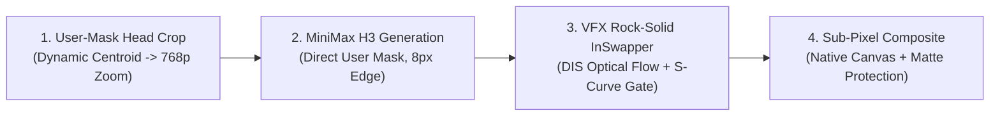

# MiniMax H3 Head-Crop + Rock-Solid InSwapper Pipeline 🎬🎭

[](https://github.com/neohh/minimax-h3-faceswap-pipeline/releases)
[](https://www.python.org/)
[](https://github.com/comfyanonymous/ComfyUI)
[](LICENSE)

A production-grade, 4-stage hybrid pipeline for cinematic actor replacement and face swapping on complex 3D head turns, profile rotations ($90^\circ$), and steep perspective tilts.

Combines the 3D volumetric consistency of **MiniMax H3 (`ref2va` DiT)** with the pixel-perfect identity likeness of **InSwapper**, featuring **VFX-Grade Optical Flow Temporal Warping** and **S-Curve Pitch Gating** to eliminate frame flickering, facial drift, and plastic AI mouth distortion.

---

## 🚀 What's New in v2.0.0: VFX Temporal Coherence Release

* **🌊 Dense Optical Flow Temporal Warping (DIS Flow)**:
  * Eliminates high-frequency skin texture flutter and frame-to-frame micro-flicker by computing backward motion vectors between frames $t$ and $t-1$.
  * Coherently blends forward-warped previous swaps ($35\%$) with the current frame ($65\%$), locking facial features rigidly to the moving skull.
* **📐 S-Curve Smoothstep Face Gate (Extreme Tilt Anti-Popping)**:
  * Automatically detects vertical head tilt (Pitch $> 35^\circ$, looking straight up into lights/disco balls).
  * Seamlessly fades swap strength down to $0\%$ via cubic smoothstep, allowing natural diffusion inpainting to handle the throat and jaw without 2D projective shearing or popping.
* **🚫 Pure Optical Sharpening (Zero GPEN Plastic Distortion)**:
  * Replaces artificial face-enhancement models (GPEN/GFPGAN) that cause uncanny-valley plastic grimaces and unnatural eye shapes with gentle optical micro-contrast sharpening.
* **🎯 Dynamic 3D Mask Centroid Tracking**:
  * The head crop dynamically follows the 3D centroid of the user's ground-truth mask, ensuring the face stays framed tight regardless of dancer displacement.

---

## 🔍 The Problem: Why Standard Pipelines Fail

When replacing an actor in a medium or wide shot where the head tilts down or turns into profile:

```
Full Canvas (720x1280) ──> Face is ONLY 50x70 px! ──> VAE 8x compression ──> 7x9 Latent Tokens!
```

1. **The Latent Bottleneck & Eye Drift (MiniMax / Wan / DiT)**:
   * In a $720 \times 1280$ video, the actor's face often occupies merely $50 \times 70$ pixels.
   * Spatial VAE downsampling ($8\times$ or $16\times$) compresses the entire head into just **$7 \times 9$ latent tokens**. Both eyes together occupy **less than 1 latent patch**!
   * The diffusion model cannot resolve eyelids or pupils at this scale, resulting in "underwater/rubber-face" deformation: upon downward head tilt, the eyes morph and drift apart rather than rigidly following the skull.
2. **Why 2D Face-Swappers (InSwapper, FaceFusion, ReActor) Flicker & Drop Frames**:
   * SCRFD / RetinaFace detectors run autonomously per frame.
   * When the head turns towards profile ($>45^\circ$) or tilts steeply, facial confidence scores drop below the threshold (`det_thresh`).
   * Standard nodes skip frames with 0 detected faces, flashing the original face for 1–2 frames (violent flickering / «слёт»).

---

## 💡 The Solution: 4-Stage Hybrid Pipeline



### Stage 1: Dynamic Head Crop (768p Zoom)
Instead of wasting 96% of the GPU compute budget on background tables and streets, the script extracts a $220 \times 220$ px box dynamically centered around the user's rotoscoped face mask (with margins for hair curls and collar), upscaling it to native **$768 \times 768$**.
* **Face resolution jumps from 50 px to 500 px** ($10\times$ increase).
* **Each eye grows to ~50 px** — the VAE now has dozens of latent tokens to cleanly preserve eyelid curvature and perspective foreshortening.

### Stage 2: MiniMax H3 with Direct Mask Guidance
* Automated SAM3 person segmentation is bypassed.
* The user's hand-crafted video mask (`mask.mp4`) is fed directly into `H3RelayExpandMask` with a tight `expansion_px: 8`.
* MiniMax H3 replaces only the face and hair, using the undisturbed original hair and neck as rigid geometric anchors.

### Stage 3: VFX Rock-Solid InSwapper (Temporal Coherence)
* **Adaptive Thresholding**: SCRFD detection threshold lowered to $0.20$ for steep profile angles.
* **Zero-Drop Continuous Interpolation**: Continuous linear trajectory bridge across extreme occlusion frames.
* **5-Frame Moving-Average Smoothing**: Filters high-frequency landmark jitter, completely eliminating mesh twitching.
* **DIS Optical Flow Temporal Warping**: Seamlessly links consecutive frames, eliminating temporal noise.
* **S-Curve Face Gate**: Smoothly modulates swap intensity across extreme perspective tilts.

### Stage 4: Sub-Pixel Native Compositing & Foreground Protection
* The swapped $768\text{p}$ head is downsampled back to native patch coordinates and pasted directly into the native canvas.
* **Foreground Occlusion Protection**: User's alpha matte (e.g. wind chime tubes or dancer hands) is composited on top, keeping foreground objects $100\%$ crisp and unblurred.

---

## 🛠️ Requirements

```bash
pip install -r requirements.txt
```

* Python 3.10+
* OpenCV (`opencv-python`)
* InsightFace (`insightface`, `onnxruntime-gpu`)
* Docker container with ComfyUI & MiniMax H3 DiT installed.

---

## 🎬 Quick Start

```python
from pipeline import (
    step1_prepare_crop,
    step2_generate_minimax_h3,
    step3_rock_solid_inswapper_v2,
    step4_pixel_perfect_composite_v2
)

# 1. Dynamic crop around 3D mask
crop_coords, canvas_res, fps = step1_prepare_crop(
    source_video="input_scene.mp4",
    mask_video="user_face_mask.mp4",
    num_frames=56,
    crop_sz=220,
    dynamic_track=True
)

# 2. Diffusion base inpaint (MiniMax H3)
h3_output = step2_generate_minimax_h3("workflow/minimax_user_mask_crop_workflow.json")

# 3. VFX-Grade Rock-Solid Swapper (with Optical Flow & S-Curve Gate)
swapped_frames = step3_rock_solid_inswapper_v2(
    input_video=h3_output,
    ref_image="reference_face.jpg",
    output_swapped_video="swapped_crop.mp4",
    enable_optical_flow=True,
    enable_pitch_gate=True
)

# 4. Pixel-perfect compositing back to canvas
step4_pixel_perfect_composite_v2(
    source_video="input_scene.mp4",
    mask_video="user_face_mask.mp4",
    holdout_matte="foreground_matte.mp4",
    swapped_frames=swapped_frames,
    crop_coords=crop_coords,
    output_master_video="final_master_output.mp4"
)
```

---

## 📄 License
MIT License. Created by [neohh](https://github.com/neohh).
