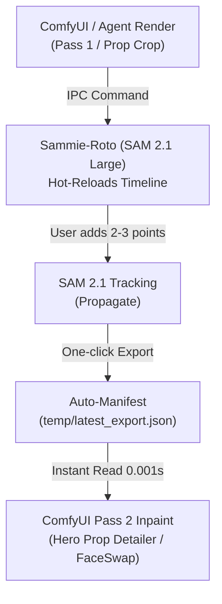

# Sammie-Roto Zero-Click Studio & Agent IPC Bridge 🎬⚡

Автоматизированный двусторонний мост между ИИ-агентом (Antigravity / CLI / ComfyUI) и автономной программой ротоскопинга **Sammie-Roto (Meta SAM 2.1 Large + MatAnyone 2)**.

---

## 🚀 Архитектурная проблема

При покадровой замене лиц (FaceSwap), мелких пропсов (пачки сигарет, этикетки, газеты) или персонажей в видео ключевым узким местом является **ручная рутина с масками**:
1. Скачать отрендеренный проход из чата/ComfyUI.
2. Открыть Sammie-Roto.
3. Через диалоговое окно `File -> Open` вручную найти файл на диске.
4. Дождаться загрузки кадров, поставить точки, нажать `Propagate`.
5. Зайти в диалог экспорта, настроить кодек, имя и путь, нажать `Export`.
6. Найти экспортированную маску и руками перетащить обратно в чат/пайплайн.

**Время потерь на 1 итерацию:** 3–5 минут на чистую возню с окнами и путями.

---

## 💡 Решение: Zero-Click IPC & Auto-Manifest Bridge



### 1. Zero-Click Hot-Reload (IPC Command Channel)
* В `sammie_main.py` встроен легковесный `QTimer` слушатель (интервал 500 мс).
* При получении команды в `temp/sammie_ipc_command.json`:
  ```json
  {
    "action": "load_file",
    "file": "Z:\\Work\\Scripts and Addons\\AI_Mask\\18931062672079.mp4"
  }
  ```
* Программа **на лету выгружает старый ролик, загружает новый и поднимает окно на передний план**.
* **Главный плюс:** Модели `SAM 2.1 Large` и `MatAnyone 2` **остаются в видеопамяти (RTX 5080)** и не тратят время на повторную инициализацию!

### 2. Auto-Export Manifest Handshake
* В `sammie/export_workers.py` встроен хук завершения экспорта.
* Как только пользователь нажимает `Export` и сохраняет маску под любым именем в любую папку, Sammie-Roto мгновенно записывает манифест `temp/latest_export.json`:
  ```json
  {
    "mask_path": "Z:\\Work\\Scripts and Addons\\AI_Mask\\чел маска.mp4",
    "output_paths": ["Z:\\Work\\Scripts and Addons\\AI_Mask\\чел маска.mp4"],
    "timestamp": "2026-11-15T15:25:39"
  }
  ```
* Агент читает манифест за миллисекунду: пользователю достаточно написать в чат **«готово»** или **«сохранил»**, и маска сразу уходит в следующий шаг.

### 3. Drag & Drop и Нативный лаунчер
* Скомпилирован нативный `.exe` с вшитой иконкой:
  * `Sammie-Roto.exe` — запуск программы из любой директории (решает проблему с OneDrive Desktop).
  * `Загрузить_видео_в_Sammie.exe` — зона сброса (Drag & Drop) любого видео прямо с рабочего стола или открытие нативного Windows диалога выбора файлов.

---

## 🛠 Содержимое инструментов

| Файл | Назначение |
|---|---|
| `send_to_sammie.py` | CLI/GUI отправщик видеофайла в открытый Sammie-Roto через IPC |
| `Загрузить_видео_в_Sammie.exe` | Нативный Windows лаунчер с поддержкой Drag & Drop |
| `Sammie-Roto.exe` | Нативный лаунчер приложения с запеченной иконкой |
| `combine_side_by_side.py` | Генератор сравнительных видео (Original vs Mask Side-by-Side) на PyAV |
| `open_in_sammie.py` | Автоматический мост агента с функцией сборки масок из памяти (`--get-mask`) |

---

## 🎬 Применение: Не только лица (Universal Hero Props)

Пайплайн объединяет:
1. **Замену лиц (FaceSwap):** трекинг головы в профиль и при наклонах.
2. **Пропсы и предметы:** пачки сигарет («Космос»), стопки газет с типографикой, стаканы, надписи, логотипы.
3. **Персонажей целиком:** выделение силуэтов танцоров, одежды, конечностей с идеальным сохранением динамики.
